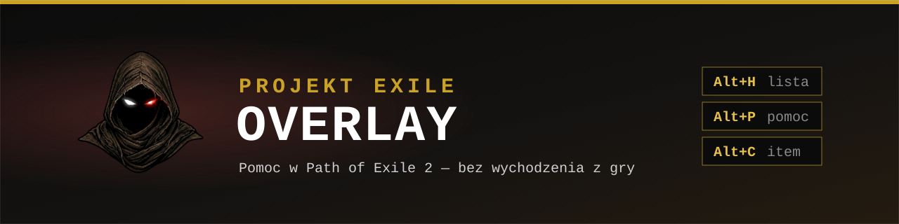
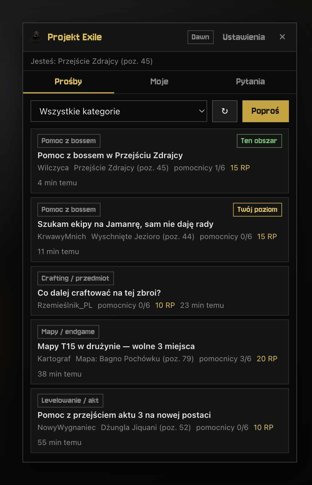
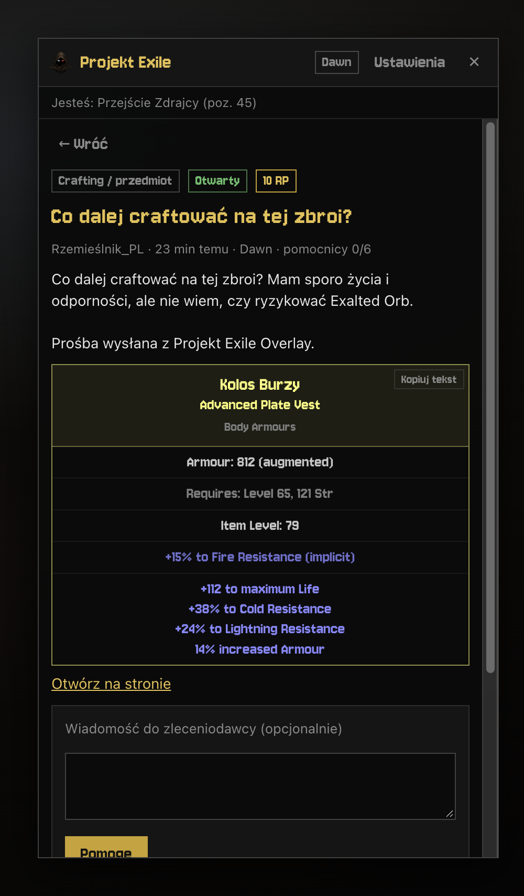
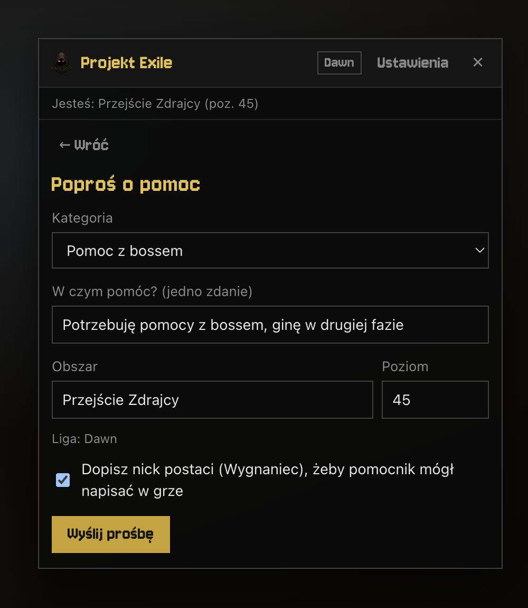
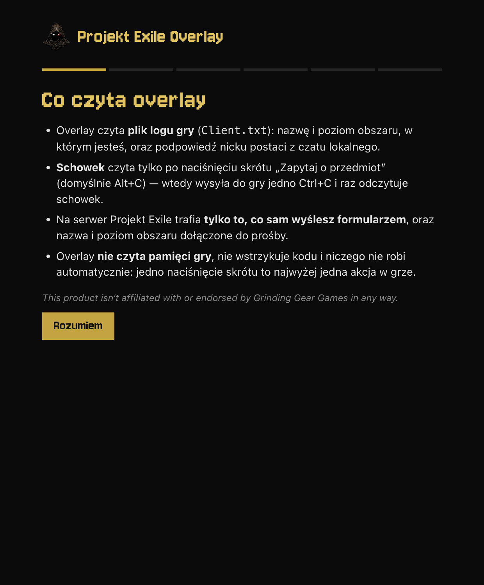
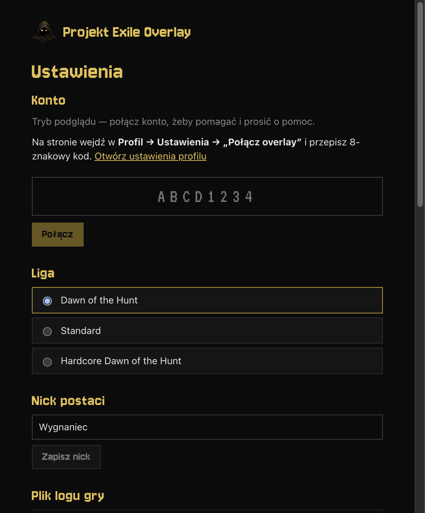

<p align="center">
  
</p>

<p align="center">
  <a href="https://github.com/slapinskiDEV/projekt-exile-overlay/releases/latest/download/Projekt-Exile-Overlay-Setup.exe"></a>
</p>

<p align="center">
  <a href="https://github.com/slapinskiDEV/projekt-exile-overlay/releases/latest"></a>
  <a href="https://github.com/slapinskiDEV/projekt-exile-overlay/releases/latest"></a>
  
  
  <a href="LICENSE"></a>
</p>

<p align="center">
  <b>Poproś o pomoc z bossem, mapami albo craftingiem i pomagaj innym — prosto z gry.</b><br>
  Wszystko trafia do <a href="https://projektexile.pl/contracts">Kontraktów</a> i na forum
  <a href="https://projektexile.pl">Projekt Exile</a>, widoczne od razu na stronie.
</p>

> [!WARNING]
> **Instalator nie ma jeszcze podpisu cyfrowego — to normalne i bezpieczne.**
> Certyfikat do podpisywania kosztuje kilkaset złotych rocznie, więc zostanie kupiony,
> **gdy overlay zbierze więcej graczy** — im większe zainteresowanie, tym szybciej.
> Do tego czasu Windows przy pierwszym uruchomieniu pokaże niebieskie okno
> **„System Windows ochronił ten komputer”**. Trzeba je zaakceptować:
>
> 1. kliknij **„Więcej informacji”**,
> 2. kliknij **„Uruchom mimo to”**.
>
> Cały kod jest publiczny w tym repozytorium, a instalator buduje automatycznie GitHub
> Actions z oznaczonej wersji ([workflow](.github/workflows/release.yml)) — nikt nie
> składa go ręcznie na swoim komputerze.

## Jak zacząć — 3 kroki

| | |
| --- | --- |
| **1. Zainstaluj** | Pobierz [`Projekt-Exile-Overlay-Setup.exe`](https://github.com/slapinskiDEV/projekt-exile-overlay/releases/latest/download/Projekt-Exile-Overlay-Setup.exe), uruchom i zaakceptuj ostrzeżenie Windows (wyżej). Grę ustaw w trybie **okna bez ramki** (*Windowed Fullscreen*). |
| **2. Połącz konto** | Na [projektexile.pl → Ustawienia → „Połącz overlay”](https://projektexile.pl/profile/settings#overlay) wygeneruj kod i wpisz go w overlayu. Bez konta działa **podgląd** próśb. |
| **3. Graj** | **Alt+H** — lista próśb, **Alt+P** — poproś o pomoc, **Alt+C** — zapytaj o przedmiot pod kursorem. |

Overlay sam sprawdza aktualizacje przy starcie i pyta, czy zainstalować nową wersję.

## Jak to wygląda

<table>
  <tr>
    <td width="50%" valign="top">
      
      <p align="center"><b>Alt+H</b> — prośby w Twojej lidze: najpierw ten sam obszar, potem podobny poziom.</p>
    </td>
    <td width="50%" valign="top">
      
      <p align="center"><b>Alt+C</b> — przedmiot z gry jako karta, jak w grze. Jedno kliknięcie „Pomogę”.</p>
    </td>
  </tr>
  <tr>
    <td width="50%" valign="top">
      
      <p align="center"><b>Alt+P</b> — jedno zdanie; obszar i poziom dopisują się z logu gry.</p>
    </td>
    <td width="50%" valign="top">
      
      <p align="center">Przy pierwszym uruchomieniu: co dokładnie czyta overlay.</p>
      
      <p align="center">Ustawienia: liga, nick, skróty, dźwięk, konto.</p>
    </td>
  </tr>
</table>

## Skróty

| Skrót | Akcja |
| --- | --- |
| **Alt+H** | Pokaż / ukryj panel z prośbami (Esc też chowa) |
| **Alt+P** | „Poproś o pomoc” — kategoria, jedno zdanie, obszar i poziom z logu gry |
| **Alt+C** | „Zapytaj o przedmiot” — najedź kursorem na przedmiot i naciśnij |

Skróty zmienisz w ustawieniach (ikona w zasobniku systemowym → Ustawienia).
**Jedno naciśnięcie to najwyżej jedna akcja w grze.**

## Wymagania

- Windows 10 lub 11 (64-bit).
- Gra w trybie **okna bez ramki** (*Windowed Fullscreen* / *Borderless*) — w trybie
  pełnoekranowym system nie pozwala rysować niczego nad grą.
- Konto na [projektexile.pl](https://projektexile.pl/register), jeśli chcesz prosić
  o pomoc i pomagać (do samego podglądu niepotrzebne).

## Co overlay czyta, a czego nie robi

**Czyta:**

- **Plik logu gry `Client.txt`** — tylko nazwę i poziom obszaru, w którym jesteś, oraz
  podpowiedź nicku (nick zawsze potwierdzasz sam).
- **Schowek** — wyłącznie po naciśnięciu **Alt+C**: overlay wysyła wtedy do gry **jedno**
  Ctrl+C i **raz** odczytuje schowek.

**Wysyła na serwer Projekt Exile** tylko to, co sam wyślesz formularzem (prośba,
zgłoszenie, wiadomość, pytanie, odpowiedź), plus nazwę i poziom obszaru dołączone do
prośby (możesz je poprawić albo usunąć przed wysłaniem).

**Nie robi:**

- nie czyta pamięci gry, nie wstrzykuje kodu, nie modyfikuje plików gry;
- nie robi niczego automatycznie i nie czyta schowka ani ekranu bez naciśnięcia skrótu;
- nie wysyła ścieżek plików ani nazwy komputera.

To zgodne z zasadami Grinding Gear Games dla narzędzi firm trzecich.

## Prywatność

Ustawienia są w `%APPDATA%\Projekt Exile Overlay\settings.json`. Token urządzenia jest
szyfrowany mechanizmem systemu Windows (DPAPI). Overlay łączy się wyłącznie
z `projektexile.pl` (API i powiadomienia na żywo) oraz z GitHubem (aktualizacje).
Urządzenie odłączysz w ustawieniach overlaya („Rozłącz konto”) albo na stronie.

## Coś nie działa?

- **Overlay nie widać nad grą** — przełącz grę na *Windowed Fullscreen*.
- **Nie widać obszaru** — sprawdź w ustawieniach ścieżkę do `Client.txt`. Jeśli grasz
  w polskiej wersji, a obszar się nie pojawia, zgłoś to z kilkoma liniami z `Client.txt`
  z momentu wejścia do obszaru.
- Błędy i pomysły: [Issues](https://github.com/slapinskiDEV/projekt-exile-overlay/issues)
  albo [Zgłoszenia na stronie](https://projektexile.pl/feedback).

<details>
<summary><b>Dla programistów</b> — uruchomienie z kodu, wydania, decyzje projektowe</summary>

### Uruchomienie z kodu

Wymagany Node.js 22+.

```bash
npm install
npm run dev          # overlay z przeładowaniem (Electron + Vite)
npm run typecheck    # TypeScript: proces główny, preload i interfejs
npm test             # vitest
npm run build        # bundle do out/
npm run dist         # instalator NSIS do dist/ (na Windows)
```

- `PE_API_URL` — inny adres API, np. `PE_API_URL=http://localhost:3000/api/overlay npm run dev`.
- `src/main` — proces główny: okna, zasobnik, skróty, śledzenie logu, Ctrl+C i schowek,
  aktualizacje, ustawienia, klient API.
- `src/preload` — most `window.overlay` (contextIsolation, bez Node w interfejsie).
- `src/renderer` — interfejs React.
- `src/shared` — kontrakt API (`api-types.ts`, kopia 1:1 z serwisu), parser przedmiotu
  (`poe-item.ts`, kopia 1:1 z serwisu), parser logu, typy wspólne.
- `scripts/generate-sound.mjs` — generuje dźwięk powiadomienia, `scripts/make-ico.mjs` —
  składa `build/icon.ico`.

#### Wydanie

1. Podnieś `version` w `package.json` i zrób commit.
2. `git tag vX.Y.Z && git push origin main vX.Y.Z`.
3. Workflow `Release` zbuduje instalator na `windows-latest` i opublikuje go w Releases
   razem z `latest.yml` (z niego korzysta automatyczna aktualizacja).

### Decyzje projektowe MVP

Wybory podjęte przy MVP (do zmiany, jeśli się nie sprawdzą):

- **Stos:** Electron 45, electron-vite 6, React 19, TypeScript 5.9, vitest. TypeScript 7
  (natywny) celowo pominięty — za świeży.
- **Okna:** jedno przezroczyste okno nad całym **głównym** monitorem, zawsze na wierzchu.
  Przepuszcza kliknięcia do gry, a łapie je tylko, gdy kursor jest nad panelem albo
  okienkiem powiadomienia. Ukryty panel nie przejmuje fokusu. Kreator i ustawienia to osobne,
  zwykłe okno. Inne monitory nie są obsługiwane.
- **Kolejność kreatora:** prywatność → liga → konto → `Client.txt` → nick. Plik logu jest
  przed nickiem (spec podaje odwrotnie), żeby podpowiedź nicku była już dostępna.
- **Ctrl+C bez modułów natywnych:** stały, ukryty proces PowerShella z
  `SendKeys.SendWait('^c')` (uruchamiany raz, bo start PowerShella trwa ~0,5 s), potem
  200 ms przerwy i jeden odczyt schowka. Jeśli gracz wciąż trzyma Alt, gra dostaje
  Ctrl+Alt+C (rozszerzony opis) — parser to obsługuje. Implementacja jest za interfejsem
  `KeySender` (`src/main/key-sender.ts`) i da się ją podmienić.
- Schowek **nie** jest czyszczony przed Ctrl+C (to nadpisałoby zawartość schowka gracza).
  Skutek uboczny: jeśli Ctrl+C nie trafi w przedmiot, a w schowku był wcześniej skopiowany
  przedmiot, formularz pokaże ten wcześniejszy — gracz widzi kartę przed wysłaniem.
- Alt+C przy otwartym panelu najpierw chowa panel (Ctrl+C musi trafić do gry). Bez konta
  i przy nieobsługiwanej wersji Alt+C nie wysyła nic do gry, tylko pokazuje powód.
- **Jedna akcja na naciśnięcie:** każdy skrót ma 400 ms blokady, więc autopowtarzanie
  przytrzymanego klawisza nie wywoła akcji drugi raz.
- **Walidacja skrótów:** wymagany modyfikator (Alt/Ctrl) albo klawisz F1–F24; zabronione
  duplikaty, samo Shift+litera, Ctrl+C i Ctrl+V. Skrót zajęty przez inną aplikację jest
  zgłaszany w ustawieniach.
- **Log:** odczyt co 500 ms (stat + dopisane bajty), na starcie ostatnie 256 KB pliku.
  Obsługiwane: `Generating level N area "…"`, `: You have entered X.` i
  `[SCENE] Set Source [X]` (PoE 2). **Polskie warianty** (`Wkroczono do`, `Wszedłeś do`,
  `Weszłaś do`, `Wchodzisz do`) to **przypuszczenia** — nie zweryfikowane na prawdziwym
  logu polskiego klienta. Wzorce są w tablicach w `src/shared/log-parser.ts`.
- **Autowykrycie `Client.txt`:** domyślne ścieżki Steama (z bibliotekami z
  `libraryfolders.vdf`) i wersji samodzielnej GGG w `Program Files (x86)` / `Program Files`.
- **Nick** nie jest wysyłany automatycznie. W formularzu prośby jest zaznaczone pole
  „Dopisz nick postaci”, które dokleja `(nick w grze: X)` do zdania — gracz widzi to i może
  odznaczyć.
- **Liczba miejsc przy mapach** (spec 0160) nie jest w formularzu: kontrakt API nie ma
  takiego pola, a serwer ma stały limit 6 pomocników.
- **Nazwa urządzenia** przy parowaniu: stała „Projekt Exile Overlay (Windows)” — bez nazwy
  komputera.
- **Powiadomienia:** odpytywanie co 25 s zawsze, a Realtime (Supabase, `postgres_changes`
  na `user_notifications`) tylko przyspiesza pobranie; przy błędzie Realtime zostaje
  odpytywanie. Przy pierwszym pobraniu pokazywane są najwyżej 3 najnowsze nieprzeczytane.
  Pokazane okienkiem są oznaczane jako przeczytane (także na stronie). Okienko znika po
  6 s, pytanie „przedłużyć?” po 20 s.
- **Token** szyfrowany `safeStorage`; jeśli system nie udostępnia szyfrowania — zapis
  jawnym tekstem (tylko w profilu użytkownika).
- **Aktualizacje:** sprawdzenie przy starcie i z zasobnika; po „Zainstaluj” pobranie
  i natychmiastowa instalacja z ponownym uruchomieniem. Działa tylko w wersji
  zainstalowanej. Blokada „Zaktualizuj overlay” przy wersji poniżej `minVersion`
  z `/version` albo po dowolnej odpowiedzi HTTP 426.
- **Instalator:** NSIS z wyborem katalogu (nie „jednym kliknięciem”), instalacja dla
  bieżącego użytkownika, skrót na pulpicie i w menu Start. Bez autostartu z Windows.
- **Wygląd:** kolory serwisu, czcionka pikselowa Jersey 10 (ta sama co na stronie) i VT323,
  dołączone lokalnie; tekst ciągły w Segoe UI dla czytelności. Logo z serwisu,
  `build/icon.ico` złożony skryptem. Dźwięk powiadomienia syntezowany skryptem (bez obcej
  licencji).

</details>

---

<p align="center">
  <a href="LICENSE">MIT</a> © Projekt Exile ·
  <i>This product isn't affiliated with or endorsed by Grinding Gear Games in any way.</i>
</p>
